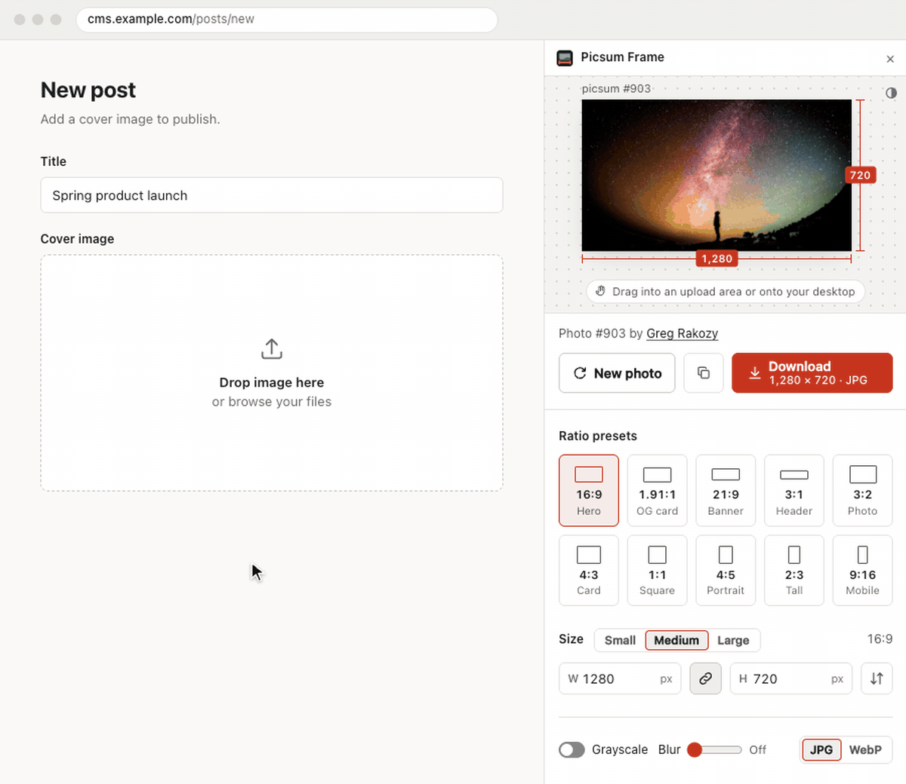
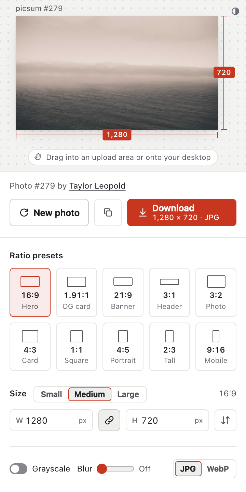
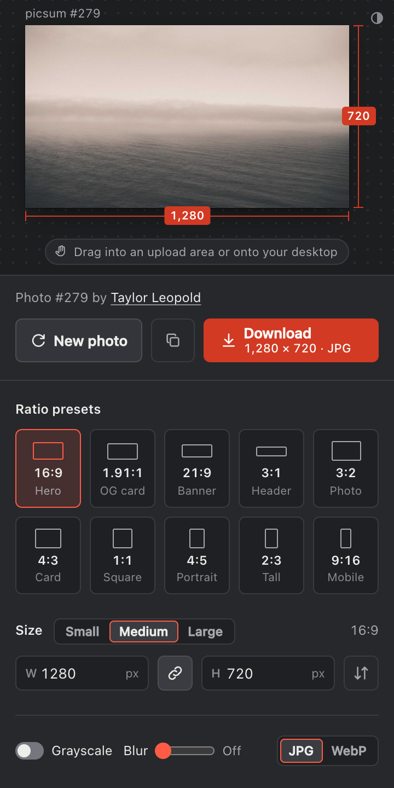

# Picsum Frame

A Chrome side-panel extension that generates placeholder photos from [Lorem Picsum](https://picsum.photos/) at an exact size, previews them, and lets you download the ones you like or drag them straight into a page's upload area.

<p align="center">
  
</p>

<p align="center">
  
  
</p>

## Install

1. Open `chrome://extensions`.
2. Turn on **Developer mode** (top right).
3. Click **Load unpacked** and select this folder.
4. Pin **Picsum Frame** to the toolbar. Clicking it, or pressing <kbd>Alt</kbd>+<kbd>Shift</kbd>+<kbd>P</kbd>, opens it in Chrome's side panel (Chrome 116 or later).

## Use

- **Ratio presets**: 16:9 Hero, 1.91:1 OG card, 21:9 Banner, 3:1 Header, 3:2 Photo, 4:3 Card, 1:1 Square, 4:5 Portrait, 2:3 Tall, 9:16 Mobile.
- **Small / Medium / Large**: picks a standard size for the current ratio (e.g. 16:9 → 640×360, 1280×720, 1920×1080). The choice carries over when you switch presets. For custom ratios, the long edge is 640, 1280 or 2560 px. Hover a button to see its exact size.
- **Exact size**: type a width or height (1–5000 px). With the link toggle on, the aspect ratio stays locked. The arrows button swaps between portrait and landscape and keeps your Small / Medium / Large choice (16:9 Medium 1280×720 → 9:16 Medium 1080×1920); custom sizes are swapped exactly.
- **New photo** (<kbd>R</kbd>): loads a different random photo. Changing size, grayscale, blur, or format keeps the current photo.
- **Download** (<kbd>D</kbd>): saves exactly the image in the preview, as `picsum-<id>-<w>x<h>.jpg|webp`.
- **Drag to upload**: drag the preview onto any page's "drop image here" area and it receives the photo as an image file (`picsum-<id>-<w>x<h>.jpg|webp`), just like a file from your disk. Drop it on the desktop or in Finder to save it there. Text fields get the image link instead. The panel stays open while you drag, and the hint under the preview shows where to drop.
- **Copy link** (<kbd>C</kbd>): copies a stable Picsum URL for the current photo and settings, ready to paste into a mockup.
- **Theme**: follows your system's light or dark setting. The button in the preview's top-right corner cycles System → Light → Dark.

The panel is 360 px wide (Chrome's narrowest side panel) and stays centered if you widen the sidebar; Chrome doesn't let extensions lock the panel's width. The preview grows to fill the height. Your last size, effects, photo, and theme are remembered between opens.

## Project structure

No build step: the extension loads plain ES modules straight from `src/`.

```
manifest.json              Manifest V3 config (side panel; downloads, sidePanel, storage; hosts: picsum.photos)
assets/icons/              Toolbar icons (generated)
docs/                      README screenshots (light and dark)
src/
  background.js            Service worker: opens the side panel, serves photos for dragging
  lib/                     Framework-free logic, unit-tested in Node
    picsum.js              Picsum URLs, fetchPhoto (with id → random fallback), photo info
    ratios.js              Ratio presets, S/M/L tiers, ratio labels, size validation
    settings.js            Persisted settings: defaults, validation, chrome.storage / localStorage
    download.js            Save a file via chrome.downloads (or <a download> as a page)
    format.js              Number and dimension formatting
    theme.js               System / light / dark theme: cycle, apply, persist
    drag-files.js          Named photo files for drag-and-drop (panel stores, worker serves)
  panel/
    panel.html             Markup
    theme-boot.js          Applies the saved theme before first paint (no flash)
    main.js                Entry point: creates the store and mounts the components
    store.js               Small observable state (get / set / subscribe / watch)
    photo-loader.js        Fetch, cancel, debounce, object URLs, drag files, credit lookup
    announce.js            Screen-reader live region
    dom.js                 byId, element builder, image decode helpers
    components/            One module per UI area; each watches only the state it renders
      stage.js             Artboard (refits as the panel resizes), redlines, develop animation, error message
      photo-drag.js        Drag payload: links for text fields, desktop download
      photo-actions.js     Credit, New photo, Copy link, Download, keyboard shortcuts
      preset-picker.js     Ratio preset radiogroup
      size-controls.js     S/M/L tiers, W × H inputs, lock, swap, validation
      effects-controls.js  Grayscale, blur, format
      theme-toggle.js      System → Light → Dark theme button
    styles/                tokens (light-dark() colors), base, buttons, one stylesheet per component
scripts/generate-icons.mjs Dependency-free PNG icon generator
tests/                     node:test unit tests for src/lib and the store
PRODUCT.md                 Product context for future design work
```

State flows one way: components call `actions.updateSettings(patch, { reload })` and re-render from the store. Settings are saved whenever they change.

## Develop

Requires Node 20+ for the scripts. No dependencies are needed.

- `npm test`: run the unit tests.
- `npm run icons`: regenerate `assets/icons/`.
- After editing, click the reload icon on the extension card in `chrome://extensions`.
- To work on the UI in a normal tab, serve the folder (`python3 -m http.server`) and open `/src/panel/panel.html`. It falls back to `localStorage` and a regular link download.

## License

[Apache License 2.0](LICENSE) (see also [NOTICE](NOTICE)). Photos are served by [Lorem Picsum](https://picsum.photos/) from [Unsplash](https://unsplash.com/) under their own license.

Unofficial. Not affiliated with or endorsed by Lorem Picsum or Unsplash. The extension only calls Picsum's public API and doesn't bundle or redistribute any photos.
